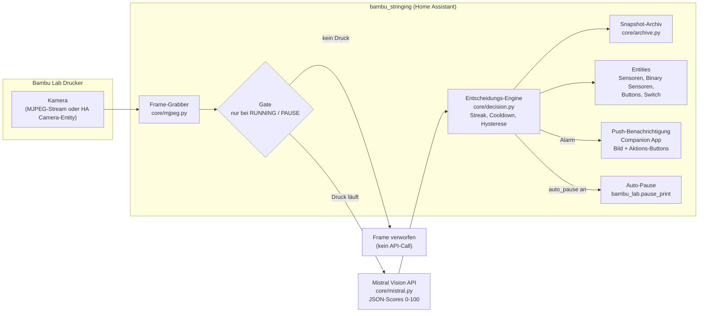

# Bambu Lab Stringing Detection

Home Assistant Custom Integration zur KI-gestützten Erkennung von Druckfehlern
(Stringing, Spaghetti, Warping, Layer-Shift) bei Bambu Lab 3D-Druckern
per Mistral Vision API.

[](custom_components/bambu_stringing/manifest.json)
[](tests/)
[](https://hacs.xyz/)
[](https://www.home-assistant.io/)

> **Hinweis:** Diese Integration wurde mit KI-Unterstützung (Mistral AI /
> Mistral Vibe) entwickelt und ist aus einer kurzen, einfachen Idee entstanden.

**Mindestanforderung:** Home Assistant Core **2026.3** oder neuer (in `hacs.json`
deklariert; u. a. nötig für das Integrations-Icon über `brand/`).

---

## Features

| Fehlerklasse | Schwere | Erkennung | Aktion |
|-------------|---------|-----------|--------|
| **Stringing** | Informativ | Feine Filamentfäden zwischen Strukturen | Push-Benachrichtigung nach Streak + Cooldown |
| **Spaghetti** | Kritisch | Entartetes Druckbild, Nest, abgelöstes Material | Sofort-Push (Alarm-Stream), optional Auto-Pause |
| **Warping** | Informativ | Abhebende Ränder, schüsselförmige Verformung | Push-Benachrichtigung nach Streak + Cooldown |
| **Layer-Shift** | Kritisch | Versetzte/wandernde Schichten, Stufen im Druckbild | Sofort-Push (Alarm-Stream), optional Auto-Pause |

- **Multi-Drucker**: Unabhängige Instanzen pro Drucker mit eigenen Schwellen, Intervallen und Archiven
- **Gate-Steuerung**: Analyse nur bei laufendem Druck (fail-closed, spart API-Kosten)
- **Snapshot-Archiv**: Automatische Speicherung mit konfigurierbarer Aufbewahrung
- **Auto-Dashboard**: Generiert automatisch eine Lovelace-Ansicht "3D-Druck"
- **Update-Hinweis**: Erkennt Datei-Updates im laufenden Betrieb und bietet per Repair-Issue einen Neustart-Button
- **Push-Benachrichtigungen**: Mit Bildanhang, Deep-Links und Aktions-Buttons (Pause/Ignorieren)
- **Steuerung**: Pause/Resume/Stop über ha-bambulab-Services

---

## Architektur



### Komponenten

| Modul | Datei | Beschreibung |
|-------|-------|-------------|
| Entscheidungs-Engine | `core/decision.py` | Thresholds, Streaks, Cooldowns, Hysterese |
| Vision-Client | `core/mistral.py` | Mistral API, JSON-Parsing, Plausibilitätsfilter |
| Prompt | `core/prompt.py` | System-Prompt v2.0 (Warping/Layer-Shift-Schema) |
| Frame-Grabber | `core/mjpeg.py` | Einzelbild aus MJPEG-Stream |
| Snapshot-Archiv | `core/archive.py` | Speicherung + Rotation (`/local/snapshots/<slug>/`) |
| Runtime | `runtime.py` | Orchestrierung, Gate, Benachrichtigungen, Services |
| Dashboard | `dashboard.py` | Auto-generierte Lovelace-Ansicht "3D-Druck" |
| Config Flow | `config_flow.py` | Setup + Optionen (Schwellen, Intervall, Modell) |

---

## Voraussetzungen

- **Home Assistant** 2026.3 oder neuer (Mindestversion in `hacs.json` deklariert; u. a. nötig für das Integrations-Icon über `brand/`)
- **Bambu Lab Drucker** (P1S, X1C, A1, etc.) mit Kamera
- **ha-bambulab Integration** ([greghesp/ha-bambulab](https://github.com/greghesp/ha-bambulab)) für Druckstatus und Steuerung
- **Mistral API-Key** ([console.mistral.ai](https://console.mistral.ai/))
- **Companion App** (Android/iOS) für Push-Benachrichtigungen (optional)

---

## Installation

### HACS (empfohlen)

1. HACS öffnen → Integrationen → "Custom Repositories"
2. Repository hinzufügen: `https://github.com/rmrosk/HABambulabStringing`
3. Kategorie: Integration
4. "Bambu Lab Stringing Detection" installieren
5. Home Assistant neu starten

### Manuell

```bash
# Integration kopieren
cp -r custom_components/bambu_stringing /config/custom_components/

# Home Assistant neu starten
```

### Einrichtung

1. **Einstellungen → Geräte & Dienste → Integration hinzufügen**
2. "Bambu Lab Stringing Detection" auswählen
3. Drucker konfigurieren:
   - Druckername (z.B. "P1S Werkstatt")
   - Mistral API-Key
   - Modell (Default: `mistral-medium-latest`)
   - Kamera-Entity (z.B. `camera.p1s_chamber` von ha-bambulab) **oder** MJPEG-URL
   - Druckstatus-Entity (z.B. `sensor.p1s_print_status` von ha-bambulab) – **Pflichtfeld**
   - ha-bambulab-Gerät (für Pause/Resume/Stop)
   - Benachrichtigungs-Ziel (Companion Apps)

---

## Konfiguration

### Optionen (nach dem Setup anpassbar)

**Einstellungen → Geräte & Dienste → Bambu Lab Stringing Detection → Konfigurieren**

| Parameter | Default | Bereich | Beschreibung |
|-----------|---------|---------|-------------|
| `check_interval_sec` | 45 | 20–300 | Prüintervall in Sekunden |
| `stringing_threshold` | 55 | 40–80 | Stringing-Score ab dem ein Frame zählt |
| `stringing_streak` | 3 | 1–5 | Aufeinanderfolgende Frames über Schwelle für Alarm |
| `spaghetti_threshold` | 70 | 50–90 | Spaghetti-Score für kritischen Alarm |
| `warping_threshold` | 60 | 40–80 | Warping-Score ab dem ein Frame zählt |
| `layer_shift_threshold` | 70 | 50–90 | Layer-Shift-Score für kritischen Alarm |
| `stringing_cooldown_min` | 15 | 5–60 | Cooldown zwischen Benachrichtigungen (Minuten) |
| `auto_pause` | aus | an/aus | Automatisch pausieren bei Spaghetti/Layer-Shift |
| `api_key` | – | – | API-Key ändern (leer = behalten) |
| `mistral_model` | `mistral-medium-latest` | konfigurierbar | Mistral Vision Modell |
| `snapshot_retention_days` | 14 | 1–90 | Snapshot-Aufbewahrung in Tagen |
| `running_states` | `RUNNING,PAUSE` | konfigurierbar | Druckstatus-Werte für "läuft" |
| `notify_services` | automatisch | wählbar | Push-Ziel (Companion Apps) |
| `deep_link` | auto | konfigurierbar | Deep-Link der Benachrichtigung |
| `pause_service` | `bambu_lab.pause_print` | konfigurierbar | Service-Pfad für Pause |
| `resume_service` | `bambu_lab.resume_print` | konfigurierbar | Service-Pfad für Resume |
| `stop_service` | `bambu_lab.stop_print` | konfigurierbar | Service-Pfad für Stop |
| `manual_context` | leer | optional | Manueller Druckkontext (z.B. "PLA, 0.2 mm") |

---

## Entities

Pro Drucker werden folgende Entities angelegt (Beispiel: Druckername "P1S Werkstatt"):

### Sensoren

| Entity | Beschreibung |
|--------|-------------|
| `sensor.p1s_werkstatt_stringing_score` | Stringing-Score (0–100) |
| `sensor.p1s_werkstatt_spaghetti_score` | Spaghetti-Score (0–100) |
| `sensor.p1s_werkstatt_warping_score` | Warping-Score (0–100) |
| `sensor.p1s_werkstatt_layer_shift_score` | Layer-Shift-Score (0–100) |
| `sensor.p1s_werkstatt_api_calls` | Anzahl API-Aufrufe (gesamt) |
| `sensor.p1s_werkstatt_events` | Erkannte Ereignisse (gesamt) |
| `sensor.p1s_werkstatt_last_check` | Zeitpunkt der letzten Prüfung |

### Binary Sensoren

| Entity | Beschreibung |
|--------|-------------|
| `binary_sensor.p1s_werkstatt_print_failure` | Druckfehler (Spaghetti erkannt) |
| `binary_sensor.p1s_werkstatt_stringing_detected` | Stringing erkannt |
| `binary_sensor.p1s_werkstatt_warping_detected` | Warping erkannt |
| `binary_sensor.p1s_werkstatt_layer_shift_detected` | Layer-Shift erkannt |

### Buttons

| Entity | Beschreibung |
|--------|-------------|
| `button.p1s_werkstatt_pause` | Druck pausieren (via ha-bambulab) |
| `button.p1s_werkstatt_resume` | Druck fortsetzen |
| `button.p1s_werkstatt_stop` | Druck stoppen |
| `button.p1s_werkstatt_check_now` | Sofort prüfen (ein Frame analysieren) |
| `button.p1s_werkstatt_reset` | Erkennung zurücksetzen |

### Switch

| Entity | Beschreibung |
|--------|-------------|
| `switch.p1s_werkstatt_mute` | Stumm für diesen Druck |

---

## Services

| Service | Beschreibung |
|---------|-------------|
| `bambu_stringing.check_now` | Sofort einen Frame analysieren (unabhängig vom Intervall) |
| `bambu_stringing.mute_for_print` | Stummschaltung für den laufenden Druck umschalten |
| `bambu_stringing.reset_detection` | Streaks, Flags und Cooldowns zurücksetzen (Stummschaltung bleibt) |

Alle Services akzeptieren `device_id` oder `entity_id` als Target.

---

## Dashboard

Die Integration generiert automatisch eine Lovelace-Ansicht **"3D-Druck"** im Sidebar:

- **Header-Badges**: Druckfehler-Alarm, Druckfortschritt, Düsentemperatur, Restzeit
- **Kamera**: Live-View der Druckkammer (oder Snapshot-Fallback)
- **Modell-Vorschau**: Cover-Bild des zu druckenden Modells (image-Entity aus ha-bambulab) neben der Kamera
- **Score-Verlauf**: History-Graph mit allen 4 Scores + Detektions-Binary-Sensoren
- **Informationen**: Status-Tiles (Fehler, API-Calls, Ereignisse, letzte Prüfung)
- **Aktionen**: Pause/Resume/Stop/Reset Buttons + Stumm-Schalter

Das Dashboard wird bei jedem (Re)Load vollständig regeneriert. Manuelle Edits werden überschrieben (by design).

---

## Benachrichtigungen

Push-Benachrichtigungen über die Companion App mit:

- **Bildanhang**: Aktueller Snapshot (`/local/snapshots/<slug>/latest.jpg`)
- **Deep-Link**: Direkt zur Geräte-Seite des Druckers
- **Aktions-Buttons**:
  - "Pause" – Druck pausieren (bei Spaghetti/Layer-Shift)
  - "Ignorieren" – Stummschaltung für diesen Druck
- **Kritische Alarme** (Spaghetti, Layer-Shift): `alarm_stream` Channel, hohe Priorität

---

## Snapshot-Archiv

Snapshots werden unter `/config/www/snapshots/<drucker-slug>/` gespeichert:

```
snapshots/p1s_werkstatt/
├── latest.jpg              # Aktueller Snapshot (immer überschrieben)
├── frame_20260107_143022.jpg   # Archiv-Snapshots
├── frame_20260107_143112.jpg
└── scores_20260107.jsonl   # Score-Log (JSON Lines)
```

- Aufbewahrung konfigurierbar (1–90 Tage, Default: 14)
- `latest.jpg` bleibt immer erhalten
- Erreichbar über `/local/snapshots/<slug>/latest.jpg`

---

## Tests

```bash
# Alle Tests (86 Tests)
python3 -m pytest -q

# Einzelne Module
python3 -m pytest tests/test_decision.py -q
python3 -m pytest tests/test_mistral.py -q
python3 -m pytest tests/test_smoke_integration.py -q
```

| Test-Modul | Inhalt |
|-----------|--------|
| `test_decision.py` | Entscheidungs-Engine (Streaks, Cooldowns, Hysterese) |
| `test_mistral.py` | Vision-Client (Parsing, Plausibilität, Fehlerbehandlung) |
| `test_mjpeg.py` | Frame-Grabber (SOI/EOI-Suche, Timeouts) |
| `test_archive.py` | Snapshot-Archiv (Speicherung, Rotation, Pruning) |
| `test_prompt.py` | Prompt-Texte (Vollständigkeit, Schema) |
| `test_smoke_integration.py` | HA-Stubs, Runtime, Entities, Config Flow, Dashboard, Gate |

---

## Benchmark

Vergleicht Mistral Vision Modelle auf 20 lokalen Testbildern (Stringing, Spaghetti,
Warping, Layer-Shift, Clean) und ermittelt das beste Modell.

```bash
cd benchmark
pip install aiohttp

# API-Key als Umgebungsvariable (keine .env Datei)
export MISTRAL_API_KEY=sk-...

# Benchmark ausführen
python3 run_benchmark.py

# Bestes Modell automatisch als DEFAULT_MODEL setzen
python3 run_benchmark.py --apply-default
```

| Kategorie | Bilder | Dateien |
|-----------|--------|---------|
| Stringing | 6 | `stringing_1-6` |
| Spaghetti | 6 | `spaghetti_1-6` |
| Warping | 2 | `warping_1-2` |
| Layer-Shift | 4 | `layer_shift_1-4` |
| Clean | 4 | `clean_1-4` |

**Composite Score**: 60% Accuracy + 25% Speed + 15% Cost

Ergebnisse: `benchmark/results.json`

---

## Entwicklung

### Projektstruktur

```
HABambulabStringing/
├── custom_components/bambu_stringing/   # Integration
│   ├── core/                            # HA-freie Kernlogik
│   │   ├── decision.py                  # Entscheidungs-Engine
│   │   ├── mistral.py                   # Vision-Client
│   │   ├── prompt.py                    # Prompt v2.0
│   │   ├── mjpeg.py                     # Frame-Grabber
│   │   └── archive.py                   # Snapshot-Archiv
│   ├── runtime.py                       # Orchestrierung
│   ├── dashboard.py                     # Lovelace-Dashboard
│   ├── config_flow.py                   # Setup + Optionen
│   ├── sensor.py / binary_sensor.py     # Entities
│   ├── button.py / switch.py            # Entities
│   ├── icons.json / brand/              # Entity-Icons + Integrations-Icon (HA ab 2026.3)
│   └── translations/                    # de.json, en.json
├── benchmark/                           # Modell-Benchmark
│   ├── run_benchmark.py
│   ├── images/                          # 20 Testbilder
│   └── results.json
├── tests/                               # 86 Tests
├── SPEC.md                              # Spezifikation
├── RELEASE.md                           # Release-Cycle (GitHub Actions + HACS)
└── AGENTS.md                            # Entwickler-Doku
```

### Konventionen

- **Sprache**: Code/Identifier Englisch, UI-Strings/Benachrichtigungen/Logs Deutsch
- **Übersetzungen**: Bei neuen Optionen/Services `translations/de.json`, `translations/en.json` UND `strings.json` synchron pflegen
- **Interne HA-APIs**: Immer defensiv nutzen (lazy import, try/except mit deutschen Log-Meldungen)
- **Dashboard**: Wird bei jedem (Re)Load vollständig regeneriert
- **Versionierung**: SemVer in `manifest.json`

### Pre-Commit Workflow

```bash
# Tests
python3 -m pytest -q

# Benchmark + Default-Modell aktualisieren
export MISTRAL_API_KEY=sk-...
python3 benchmark/run_benchmark.py --apply-default

# Caches löschen (Projekt liegt in Nextcloud)
find . -type d -name "__pycache__" -exec rm -rf {} +
find . -type d -name ".pytest_cache" -exec rm -rf {} +
```

Der Release-Cycle (Version erhöhen → Push auf `main` → automatisches
GitHub-Release → HACS/HA-Update) ist in [RELEASE.md](RELEASE.md) dokumentiert.

### Deployment

```bash
# Integration auf den Pi kopieren
scp -r custom_components/bambu_stringing pi@homeassistant:/config/custom_components/

# HA neu starten oder Entry neu laden
# Dashboard regeneriert sich automatisch
```

---

## Roadmap

- [ ] Soll-Ist-Vergleich: 3D-Modell als Referenz für VLM (gerendertes Soll-Bild)
- [ ] Layer-spezifische Referenzbilder aus G-Code
- [ ] Kosten-Dashboard pro Druck
- [ ] Filament-spezifische Schwellen-Profile
- [ ] Webhook für externe Alarmierung

---

## Lizenz

MIT License

---

## Danksagungen

- [ha-bambulab](https://github.com/greghesp/ha-bambulab) – Bambu Lab HA Integration
- [Mistral AI](https://mistral.ai/) – Vision API und KI-gestützte Entwicklung (Mistral Vibe)
- [Home Assistant](https://www.home-assistant.io/) – Smart Home Plattform
