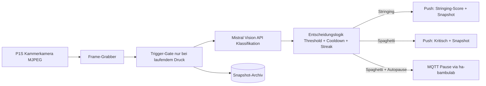

# SPEC: Stringing- und Fehlererkennung für Bambu Lab P1S mit Mistral-Modellen und Home Assistant

Version 0.1 (Draft) · Zielgerät: Bambu Lab P1S · Zielplattform: Home Assistant (Raspberry Pi) · Backend: Mistral Vision API

## 1. Zielsetzung

Das System überwacht laufende Drucke auf dem P1S über die interne Kammerkamera und erkennt zwei Fehlerklassen:

1. Stringing: feine Filamentfäden und Spinnweben auf der Modelloberfläche (Qualitätsproblem, informativ).
2. Spaghetti / Totalausfall: entartetes Druckbild, vom Druckbett abgelöstes Material, "Nest"-Zustand (kritisch, handlungsrelevant).

Bei Erkennung wird eine Push-Benachrichtigung mit Kamera-Snapshot an die Companion App gesendet. Bei kritischen Fehlern kann optional der Druck automatisch pausiert werden (konfigurierbar, Standard: nur benachrichtigen).

Nicht-Ziele: automatische Korrektur von Slicer-Einstellungen, Erkennung anderer Defekte (Warping, Layer-Shift), Auswertung von AMS/Filamentdaten.

## 2. Recherchestand (Warum Eigenbau)

- Der P1S hat keine Onboard-KI. Bambus Spaghetti Detection läuft nur auf X1C/X1E über die NPU des Druckers.
- Existierende Lösung: ha-bambu-lab-p1-spaghetti-detection (HA-Integration, nutzt den Obico-ML-Server für Spaghetti-Erkennung und ha-bambulab für Steuerung). Deckt nur Totalausfall ab, kein Stringing.
- Obico (Cloud/Self-Hosted) erkennt ebenfalls nur die Spaghetti-Klasse, kein feines Stringing.
- Die P1S-Kammerkamera liefert rohes MJPEG; Zugriff ohne Zusatzhardware über P1Stream oder direkt über das HTTP-Interface des Druckers.
- Steuerung (Pause/Resume/Stop) läuft über das lokale MQTT-Interface des Druckers, in HA über die ha-bambulab-Integration gekapselt.
- Fazit: Für Spaghetti-Erkennung gäbe es Fertiges. Der eigenständige Wert dieses Projekts liegt in der Stringing-Erkennung per Vision-LLM (Mistral), die klassische CNN-Detektoren nicht leisten. Die Spaghetti-Erkennung kommt mit derselben Pipeline nahezu kostenlos mit.

## 3. Architektur



### 3.1 Komponenten


| Komponente            | Umsetzung                                                                           | Bemerkung                                                               |
| --------------------- | ----------------------------------------------------------------------------------- | ----------------------------------------------------------------------- |
| Kamera-Zugriff        | Interne P1S-Kamera als MJPEG-Quelle; Einbindung als HA-Kamera-Entität               | Alternativ P1Stream als Proxy, wenn direkter Zugriff instabil           |
| Frame-Grabber         | Python-Skript oder HA-Automation: Snapshot alle N Sekunden während aktivem Druck    | N = 30–60 s (Stringing entwickelt sich langsam)                         |
| Druckstatus-Gate      | MQTT-Topics des Druckers via ha-bambulab (gcode\_state = RUNNING)                   | Verhindert API-Kosten im Leerlauf                                       |
| Vision-Klassifikation | Mistral-Vision-Modell über API mit strukturiertem Prompt, JSON-Antwort              | Läuft als leichter Python-Dienst; Raspberry Pi reicht, da nur API-Calls |
| Entscheidungslogik    | Score-Schwellen, Streak-Logik (n aufeinanderfolgende Positiv-Erkennungen), Cooldown | Anti-Flapper, verhindert Notification-Spam                              |
| Benachrichtigung      | HA notify.mobile\_app mit Snapshot als Anhang                                       | Companion App                                                           |
| Pausierung            | Service-Call auf ha-bambulab (pause\_print)                                         | Nur bei Spaghetti-Klasse und wenn Autopause aktiviert                   |
| Archiv                | Snapshots + Scores als Dateien und optional HA-Sensor-Historie                      | Für Nachjustierung der Schwellen                                        |


### 3.2 Datenfluss pro Zyklus

1. Gate prüft: Drucker druckt (gcode\_state RUNNING) und letzte Prüfung älter als Intervall.
2. Frame wird aus dem MJPEG-Stream gezogen, als JPEG lokal gespeichert.
3. Frame wird base64-kodiert an die Mistral-Vision-API gesendet mit Klassifikations-Prompt.
4. Antwort (JSON: stringing\_score 0–100, spaghetti\_score 0–100, Hinweise) wird ausgewertet.
5. Streak-Logik: Stringing-Alarm erst nach 2–3 aufeinanderfolgenden Frames über Schwelle; Spaghetti-Alarm sofort bei Score über Schwelle.
6. Aktionen: Push-Benachrichtigung, optional Pause, Snapshot ins Archiv.
7. Cooldown: max. eine Stringing-Benachrichtigung pro 15 Minuten; Spaghetti bleibt einmalig pro Druck.

## 4. Mistral-Modell-Einsatz

### 4.1 Modellwahl

- Vision-Modell über Mistral API (aktuelle Pixtral-/Vision-Variante; genaue Version bei Implementierung festlegen und konfigurierbar hinterlegen).
- Begründung: Raspberry Pi kann keine lokalen VLMs sinnvoll betreiben; die Mistral API verarbeitet ein Bild in wenigen Sekunden; Kosten bleiben gering, da nur 1–2 Bilder pro Minute während aktiver Drucke anfallen.
- Datenschutz: Kamerabilder verlassen das lokale Netzwerk. Konfigurierbarer Opt-In; die Druckkammer enthält keine Personen.

### 4.2 Prompt-Design (Kern der Spec)

System-Prompt (fix):

```text
Du bist ein Inspektor für FDM-3D-Druck. Du erhältst ein Bild aus der
Druckkammer eines Bambu Lab P1S. Bewerte ausschließlich das Druckbild.

Antworte ausschließlich als JSON:
{
  "stringing_score": <0-100>,
  "spaghetti_score": <0-100>,
  "bed_adhesion_failure": <true|false>,
  "observations": "<max. 2 Sätze, deutsch>"
}

Definitionen:
- stringing_score: Schweregrad feiner Filamentfäden oder Spinnweben
  zwischen oder auf Strukturen. 0 = sauber. Typische Ursache ist
  Oozing beim Travel; nicht verwechseln mit Stützstrukturen, gewollten
  Brücken oder dünnen Design-Features.
- spaghetti_score: Wahrscheinlichkeit eines entarteten Druckbilds
  (Materialklumpen, vom Bett gelöste Teile, Nest).
- Ignoriere: Beleuchtung, Spiegelungen, Werkzeugkopf, die
  Bauteil-Geometrie selbst, Abschattungen durch den Druckkopf.
```

User-Nachricht: Bild (base64) plus optional Kontext (Filament-Typ, Layer-Höhe) zur besseren Unterscheidung von Stützen und Brücken.

### 4.3 Robustheitsmaßnahmen

- Strikte JSON-Ausgabe erzwingen (JSON-Mode/structured output der API).
- Gültigkeitsprüfung der Antwort; bei Parse-Fehler Frame verwerfen, nicht als Fehler werten.
- Plausibilitätsfilter: observations müssen zu den Scores passen; inkonsistente Antworten verwerfen.
- Kalibrierungsset: 20–50 manuell gelabelte Snapshots (sauber, Stringing leicht/mittel/stark, Spaghetti) zum Testen der Schwellen vor Inbetriebnahme.

## 5. Home-Assistant-Integration

### 5.0 Multi-Drucker-Support

Die Integration unterstützt mehrere Drucker als vollwertige Instanzen:

- Ein Geräte-Pfad pro Drucker: jedes Gerät hat eigene Entitäten (sensor.&lt;printer&gt;\_stringing\_score, sensor.&lt;printer&gt;\_spaghetti\_score, binary\_sensor.&lt;printer&gt;\_print\_failure, binary\_sensor.&lt;printer&gt;\_stringing\_detected, camera.&lt;printer&gt;\_chamber, input\_boolean.&lt;printer&gt;\_autopause), eigene Parameter (Schwellen, Intervall, Cooldown, Modell) und eigene API-Key-/MQTT-Zuordnung. Ein Drucker mit sehr kleinem Druckbett oder anderem Filament braucht andere Schwellen als ein zweiter.
- Setup: ein Drucker pro config-flow-Durchlauf. Danach lässt sich über Integration hinzufügen der nächste Drucker anlegen. Die Geräte-Seite listet alle Instanzen; jedes Panel zeigt oben klar den Druckernamen und den Seriennummern-/Host-Alias, Verwechslungen sind ausgeschlossen.
- Umschalten: für den schnellen Wechsel im Alltag wird zusätzlich eine eigene Dashboard-Ansicht empfohlen ( eine Karte pro Drucker mit Live-Kamera, Scores, Status und Kurzaktionen), weil die Geräte-Seite von HA pro Gerät ohnehin getrennt ist. Innerhalb der Integrations-Konfiguration sind alle Drucker unter einer Integrationseintragung mit mehreren Geräten erreichbar.
- Pipeline: der Grabber läuft pro Drucker als eigene Instanz mit eigenem Gate (nur der Drucker mit laufendem Druck verursacht API-Calls), eigenem Streak-Zustand, eigenem Cooldown und eigenem Snapshot-Archiv (getrennte Verzeichnisse pro Drucker).

### 5.1 Entitäten

- sensor.p1s\_stringing\_score (0–100, letzter Wert)
- sensor.p1s\_spaghetti\_score
- binary\_sensor.p1s\_print\_failure (Spaghetti erkannt)
- binary\_sensor.p1s\_stringing\_detected
- camera.p1s\_chamber (bestehende ha-bambulab-Kamera)
- input\_boolean.p1s\_autopause (Toggle, auch vom Handy bedienbar)

### 5.2 Benachrichtigungen

- notify.mobile\_app\_&lt;device&gt; mit Bildanhang und Score-Werten.
- Titel-Beispiele: "P1S: Stringing erkannt (Score 64)" / "P1S: KRITISCH – Druckfehler". Bei mehreren Druckern enthält der Titel immer den Druckernamen, damit die Zuordnung ohne Blick ins Bild möglich ist.
- Kritische Nachrichten mit critical priority der Companion App (Alarm-Stream), damit sie die Stummschaltung durchdringen.
- Deep-Link: jede Benachrichtigung enthält eine Tap-Aktion, die in der Companion App direkt auf die Geräte-Seite bzw. Dashboard-Ansicht des jeweiligen Druckers führt. Umsetzung über die notification action mit URI-Schema der Companion App (lokal://navigate oder App-Intent auf more-info/device view des konkreten Geräts). Der Link wird pro Drucker generiert und zeigt nie auf eine falsche Druckerinstanz.
- Aktionsbuttons in der Notification (Companion App): Pause (ruft pause\_print des erkannten Druckers auf) und Ignorieren (Cooldown verlängern / Stummschaltung für diesen Druck). Damit ist eine Reaktion ohne App-Öffnen möglich.

### 5.3 Automatisierung (Pseudocode)

```yaml
- alias: P1S Spaghetti erkannt
  trigger: binary_sensor.p1s_print_failure -> on
  action:
    - service: notify.mobile_app_handy
      data:
        title: "P1S: KRITISCH – Druckfehler"
        message: "Spaghetti erkannt (Score {{ states('sensor.p1s_spaghetti_score') }})."
        data:
          image: "/config/www/snapshots/p1s_latest.jpg"
          channel: alarm_stream
    - condition: input_boolean.p1s_autopause == on
    - service: bambu_lab.pause_print
```

### 5.4 Geräte-Seite (Integrations-Dashboard)

Die Integration bekommt ein vollwertiges Geräte-Panel unter Einstellungen → Geräte und Dienste. Ziel: alle relevanten Druck- und Detektionsdaten an einem Ort einsehen und verstellen, ohne YAML oder Datei-Editor.

Anzeigebereich Druckstatus (aus MQTT via ha-bambulab):

- Druckstatus (gcode\_state: RUNNING/PAUSED/FINISH/FAILED), Auftrag, Fortschritt in Prozent, verbleibende Zeit
- Aktives Werkzeug/AMS-Slot und Filamenttyp
- Düsentemperatur, Heizbetttemperatur, Kühllüfter in Prozent
- Kammerkamera-Livestream
- Aktueller Stringing- und Spaghetti-Score als Liniendiagramm (Historie des laufenden Drucks)
- Zähler API-Calls und erkannte Ereignisse des laufenden Drucks

Einstellbare Detektionsparameter (bis dahin YAML-Konfiguration, hier als verstellbare Options-UI):

- Prüintervall, Stringing-Schwelle, Streak-Anzahl, Spaghetti-Schwelle, Cooldown
- Autopause an/aus
- Modellname (z. B. bei Mistral-Versionswechsel)
- Snapshot-Aufbewahrungsdauer

Aktionen direkt von der Geräte-Seite:

- Pause/Resume/Stop des Drucks (durchgereicht an ha-bambulab)
- Manuelle Prüfung jetzt (ein Frame sofort analysieren, unabhängig vom Intervall)
- Stummschaltung der Benachrichtigungen für den laufenden Druck

Technisch: Umsetzung als config-flow-Integration mit Options-Flow. Der Options-Flow schreibt die Parameter aus Abschnitt 6, ohne Neustart von HA. Die Geräte-Seite bündelt eigene Entitäten und per device\_info verknüpfte ha-bambulab-Entitäten (Kamera, Temperatur, Status) in einer Ansicht.

Mobile Verlässlichkeit der Geräte-Seite:

- Die Companion App rendert die Geräte-Seite zuverlässig, da sie native HA-Views nutzt; kritische Funktionen (Status, Scores, Pause/Resume/Stop, Sofort-Check) sind als native Entitäten und Buttons realisiert und nicht von breiten Custom-Cards oder Desktop-Only-Layouts abhängig.
- Ergänzend zur Geräte-Seite wird eine mobile-optimierte Dashboard-Ansicht pro Standort empfohlen: eine kompakte Karte pro Drucker (Kamera-Thumbnail, Status, Score-Badges, Pause-Button), sodass der Wechsel zwischen Druckern auf dem Handy ein Tap ist.
- Benachrichtigungs-Deep-Links (Abschnitt 5.2) führen aus der Android-Notification direkt auf die Ansicht des verursachenden Druckers; getestet wird explizit im gesperrten Zustand und ohne aktive App-Session, da dort Deep-Link-Fehler typischerweise auftreten.
- Die Score-Diagramme nutzen die HA-History-Graph-Card, die auf kleinen Displays stabil skaliert.

### 5.5 Deployment-Form

Empfehlung: kleines eigenständiges Python-Paket (HA Add-on oder HACS-Custom-Integration) statt reiner YAML-Automatisierungen, weil Bild-Upload, JSON-Parsing und Streak-Logik in Python sauberer sind. Minimalvariante zum Start: HA-Automation plus Python-Skript als Sensor-Quelle; Ausbau später.

## 6. Konfigurationsparameter


| Parameter                 | Default                 | Bereich        |
| ------------------------- | ----------------------- | -------------- |
| check\_interval\_sec      | 45                      | 20–300         |
| stringing\_threshold      | 55                      | 40–80          |
| stringing\_streak         | 3                       | 1–5            |
| spaghetti\_threshold      | 70                      | 50–90          |
| stringing\_cooldown\_min  | 15                      | 5–60           |
| mistral\_model            | aktuelle Vision-Version | konfigurierbar |
| autopause\_default        | off                     | on/off         |
| snapshot\_retention\_days | 14                      | 1–90           |


## 7. Implementierungsphasen

Phase 1 – Infrastruktur: ha-bambulab installieren, Kamera-Entität verifizieren, MQTT-Zugriff und pause\_print-Service testen. Akzeptanz: manueller Pause-Test funktioniert.

Phase 2 – Frame-Pipeline: Grabber-Skript schreibt Snapshots ins HA-www-Verzeichnis, nur bei laufendem Druck. Akzeptanz: Snapshots erscheinen synchron zum Druck.

Phase 3 – Mistral-Anbindung: API-Key-Verwaltung, Prompt, JSON-Parsing, Kalibrierungsset aus 20–50 gelabelten Bildern, Schwellen bestimmen. Akzeptanz: mindestens 85% korrekte Stringing-Klassifikation auf dem Kalibrierungsset, 0 Fehlalarme auf sauberen Drucken.

Phase 4 – HA-Integration: Sensoren, Benachrichtigungen mit Bild, Autopause-Toggle. Akzeptanz: Push auf dem Handy innerhalb 10 s nach Erkennung, kritischer Alarm über Alarm-Stream.

Phase 5 – Härtung: Cooldowns, Streak-Logik, Fehlerbehandlung (API-Ausfall = kein Alarm, aber Log-Eintrag), Kostenmonitoring (API-Calls pro Druck zählen).

## 8. Risiken und Gegenmaßnahmen

- Fehlalarme durch Stützstrukturen und Brücken: klare Prompt-Definitionen plus Kalibrierungsset; Schwelle anpassbar.
- Niedrige Auflösung der P1S-Kamera und Verdeckung durch den Druckkopf: mehrere Frames pro Entscheidung (Streak) statt Einzelbild; bei Verdeckungshinweis in observations Frame neutral werten.
- API-Kosten und Latenz: Gate nur bei aktivem Druck; Intervall konfigurierbar; ein Call pro Frame.
- MQTT-Steuerung des Druckers: nur lokal, Access-Token sicher verwahren; Pause-Aktion optional und standardmäßig aus.
- Mistral-Modellversionen ändern sich: Modellname konfigurierbar, Prompt versioniert, Kalibrierungsset bleibt regression-testbar.

## 9. Offene Punkte

- Genaue Mistral-Vision-Modellversion und Preis pro Bild zum Implementierungszeitpunkt verifizieren.
- Entscheidung: direkter Kamerazugriff (HTTP des Druckers) vs. P1Stream als stabilen Proxy – in Phase 2 messen.
- Ob Stringing-Scores pro Druck als Verlauf gespeichert werden sollen (z. B. zur Filament-Diagnose).